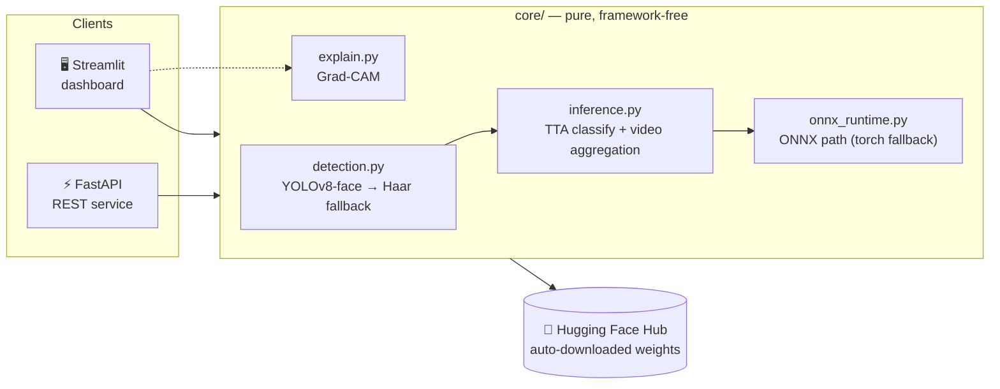
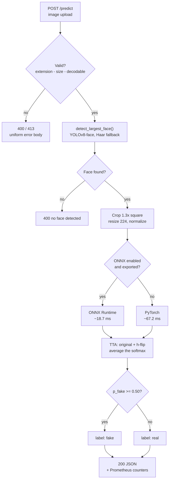
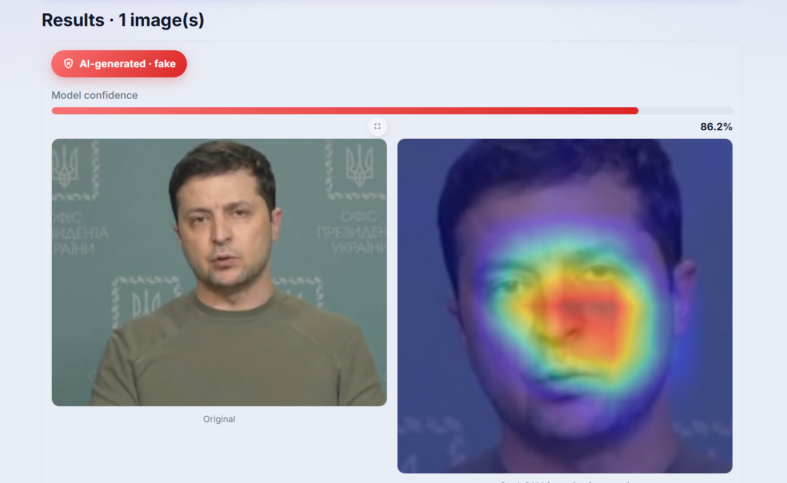
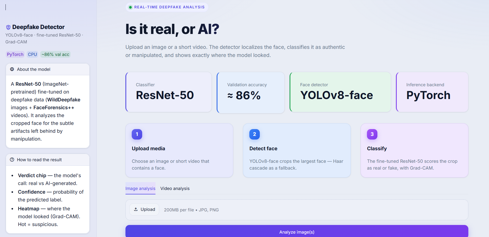
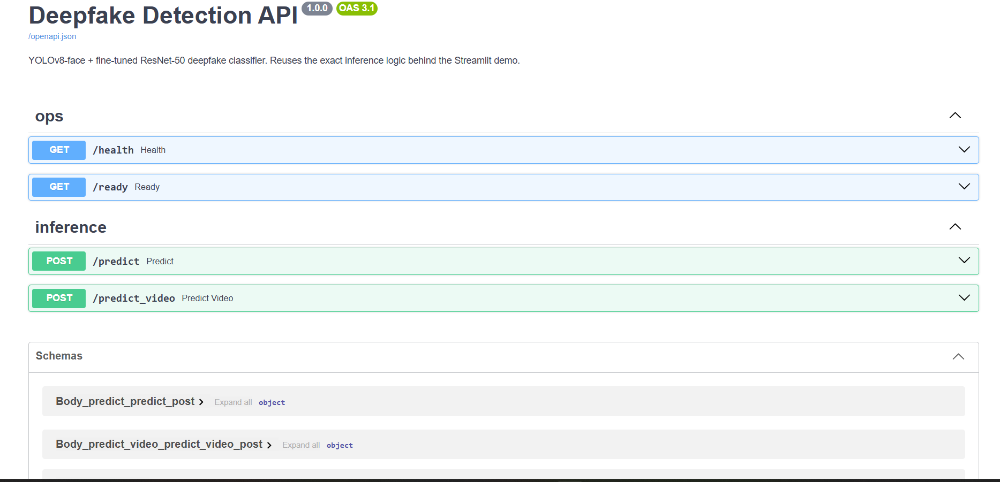

<div align="center">

# 🛡️ Deepfake Detection System

**A production-grade deepfake detection service — YOLOv8-face + fine-tuned ResNet-50, served through a hardened FastAPI backend and an interactive Streamlit dashboard.**

[](https://www.python.org/)
[](https://pytorch.org/)
[](https://fastapi.tiangolo.com/)
[](https://streamlit.io/)
[](https://onnxruntime.ai/)
[](tests/)
[](https://huggingface.co/Parimal/Resnet50_best)

</div>

---

## Overview

This project detects AI-manipulated (deepfake) faces in **images and videos**. It combines a
**YOLOv8-face** detector with a **fine-tuned ResNet-50** classifier, and explains every decision
with a **Grad-CAM** heatmap showing exactly where the model looked.

It is built as a real service, not a notebook demo:

- A **framework-free `core/` library** holds all inference logic.
- A **FastAPI** service exposes it over REST with auth, rate limiting, and Prometheus metrics.
- A **Streamlit dashboard** provides an interactive UI.
- Both front-ends import the *same* `core/` code — one implementation, zero drift.



### How a request flows



Video follows the same path per sampled frame (~5 fps, faces at least 64 px, capped at 200
frames), then applies the two-factor aggregation rule described under
[Video response](#video-response).

---

## Screenshots

**A detection, explained** — an AI-generated image pulled from the web, outside the training
data, flagged at 86.2% confidence. The Grad-CAM heatmap on the right shows which facial regions
drove the call:



**Streamlit dashboard** — model and backend at a glance, the three-step explainer, and tabs for
image or video analysis:



**Interactive API docs** — FastAPI's generated OpenAPI UI at `/docs`, with the ops and inference
endpoints and every typed schema:



---

## Key features

| | Feature |
|---|---|
| 🎯 | **Dual-mode inference** — single images and full videos (frame sampling + multi-factor verdict aggregation) |
| 🔍 | **Robust face detection** — YOLOv8-face with automatic Haar-cascade fallback |
| 🧠 | **Explainable** — Grad-CAM heatmaps show which facial regions drove the decision |
| ⚡ | **3.6× faster CPU inference** — optional ONNX Runtime path, benchmarked and verified for parity |
| 🔐 | **Hardened API** — optional API-key auth, rate limiting, upload size limits, no stack-trace leaks |
| 📊 | **Observable** — structured JSON logging + Prometheus metrics at `/metrics` |
| 🧪 | **Tested** — 19 tests (unit + API + end-to-end) with GitHub Actions CI |
| 📦 | **Zero-setup weights** — models auto-download from Hugging Face on first run |

---

## Performance

CPU inference, batch size 1, 30 iterations (see [`docs/onnx_benchmark.md`](docs/onnx_benchmark.md)):

| Backend | Latency / image | Model size | Speedup |
|---------|----------------:|-----------:|--------:|
| PyTorch (fp32) | 67.2 ms | — | 1.00× |
| **ONNX Runtime (fp32)** | **18.7 ms** | 89.6 MB | **3.60×** |
| ONNX Runtime (int8, dynamic) | 277.7 ms | 22.6 MB | 0.24× |

> **Engineering note:** dynamic int8 quantization made the model **4× smaller but slower** —
> expected for a convolution-heavy network, since dynamic quantization only accelerates
> MatMul/Linear ops, not convolutions. The default is therefore **fp32 ONNX**, chosen from
> measurement rather than assumption. ONNX output matches PyTorch to `1.2e-07`.

---

## Engineering decisions

The interesting part of this project is not the model — it is everything around it. Each choice
below was made for a stated reason, and most were settled by measurement.

- **One implementation, two front-ends.** `core/` imports neither `streamlit` nor `fastapi`, so
  the dashboard and the API cannot drift apart — both call the same `analyze_image` /
  `analyze_video`. The thresholds, TTA, and video aggregation were *wrapped*, not rewritten, so
  the renovated service returns the same verdicts as the original demo.
- **fp32 ONNX over int8 — chosen from a benchmark, not a habit.** Dynamic int8 quantization made
  the model 4x smaller but **~15x slower** (18.7 → 277.7 ms), because dynamic quantization only
  accelerates MatMul/Linear ops and ResNet-50 is convolution-heavy. The quantized export stays
  available behind a flag for memory-constrained use.
- **Models load once, at startup.** FastAPI's `lifespan` calls `warm_up()`, so the first request
  isn't slow and a broken checkpoint fails the process immediately rather than the 50th request.
  `/ready` reports the real state from `app.state`.
- **Weights live on the Hugging Face Hub** — never committed, never baked into the image. That
  keeps the repo and the image lean, removes the manual weight-placement step, and makes a fresh
  `git clone` runnable with no setup.
- **A two-factor video verdict.** A video is flagged fake only when mean `p(fake) >= 0.70` *and*
  at least 25% of sampled frames score `>= 0.80`, so a single bad frame cannot condemn a real
  video.
- **Memory treated as a first-class constraint.** Frame sampling is capped at 200 frames, uploads
  are read against a size limit instead of swallowed whole, and the container runs a single
  uvicorn worker — each additional worker would load its own ~400 MiB copy of the models.
- **Fast tests mock the models.** CI lints and tests in seconds without downloading 289 MB;
  real-weight tests (including ONNX-vs-PyTorch parity) are opt-in via `RUN_INTEGRATION=1`.
- **Containerizing found real bugs.** A clean environment surfaced a missing `omegaconf` — the
  `yolov8n-face.pt` checkpoint unpickles an omegaconf object, so `YOLO()` crashed anywhere but
  the dev machine — and OpenCV 5.0 silently dropping `cv2.CascadeClassifier`, which had broken
  the Haar fallback. Both are now pinned and documented.

---

## Quick start

**Requirements:** Python 3.11. Model weights (~289 MB) download automatically on first run.

```bash
git clone https://github.com/parimalganorkar/deepfake-detection.git
cd deepfake-detection

python -m venv env
env\Scripts\activate          # Windows
# source env/bin/activate     # macOS / Linux
```

### Option A — Streamlit dashboard

```bash
pip install -r requirements.txt
streamlit run app.py
```

Opens at **http://localhost:8501**.

### Option B — FastAPI service

```bash
pip install -r requirements-api.txt
uvicorn api.main:app --host 0.0.0.0 --port 8000
```

Interactive OpenAPI docs at **http://localhost:8000/docs**.

### Option C — Docker (recommended for the API)

No Python setup needed — the image is CPU-only and runs as a non-root user:

```bash
docker compose up --build
```

The API comes up on **http://localhost:8000**. Weights are *not* baked into the image; they
download from Hugging Face on first start into the `hf-cache` volume, so restarts are instant.
First boot takes a few minutes (289 MB of weights); after that, ~12 seconds.

```bash
docker compose ps          # STATUS shows "healthy" once the HEALTHCHECK passes
docker compose logs -f     # structured JSON logs
docker compose down        # stop (add -v to drop the cached weights too)
```

Plain Docker, if you prefer:

```bash
docker build -t deepfake-api .
docker run -p 8000:8000 -v hf-cache:/cache/huggingface deepfake-api
```

### Enable the faster ONNX backend (optional)

```bash
python -m scripts.export_onnx     # exports + quantizes + benchmarks
set DEEPFAKE_USE_ONNX=1           # Windows  (export DEEPFAKE_USE_ONNX=1 on Linux/macOS)
```

---

## API reference

| Method | Endpoint | Description |
|--------|----------|-------------|
| `GET` | `/` | Redirects to `/docs` |
| `GET` | `/health` | Liveness probe — `{"status":"ok"}` |
| `GET` | `/ready` | Readiness probe — reports whether models are loaded |
| `GET` | `/metrics` | Prometheus metrics (request count, latency, predictions) |
| `POST` | `/predict` | Classify a single image (`png`, `jpg`, `jpeg` — max 10 MB) |
| `POST` | `/predict_video` | Classify a video (`mp4`, `mov`, `avi`, `mkv` — max 50 MB) |

### Example

```bash
curl -X POST http://localhost:8000/predict \
     -F "file=@face.jpg"
```

```json
{
  "label": "fake",
  "confidence": 0.774,
  "p_fake": 0.774,
  "p_real": 0.226,
  "faces_detected": 1,
  "processing_ms": 271
}
```

`label` is `"fake"` when `p_fake >= 0.5`; `confidence` is the probability of the predicted label.

### Video response

`/predict_video` returns per-frame scores plus an aggregate verdict. A video is flagged **fake**
only when *both* conditions hold — mean `p(fake) >= 0.70` **and** at least 25% of sampled frames
score `>= 0.80`. This two-factor rule avoids single-frame false positives.

```json
{
  "aggregate": {
    "label": "fake", "is_fake": true,
    "mean_p_fake": 0.81, "max_p_fake": 0.97,
    "highly_fake_count": 34, "highly_fake_rate": 0.68, "num_frames": 50
  },
  "frames": [{ "frame_index": 0, "timestamp_s": 0.0, "p_fake": 0.79 }],
  "processing_ms": 8420
}
```

### Error handling

| Status | Meaning |
|--------|---------|
| `400` | No file, unsupported extension, corrupt media, or no face detected |
| `401` | Missing/invalid API key (only when `DEEPFAKE_API_KEY` is set) |
| `413` | Upload exceeds the size limit |
| `429` | Rate limit exceeded |
| `500` | Internal error — generic message, never a stack trace |

All errors return a uniform shape: `{"error": "..."}`.

---

## Configuration

Every setting is environment-overridable with the `DEEPFAKE_` prefix (see [`core/config.py`](core/config.py)):

| Variable | Default | Purpose |
|----------|---------|---------|
| `DEEPFAKE_API_KEY` | *unset* | When set, requires an `X-API-Key` header on predict endpoints |
| `DEEPFAKE_RATE_LIMIT` | `30/minute` | Per-IP rate limit |
| `DEEPFAKE_USE_ONNX` | `False` | Use the ONNX Runtime inference path |
| `DEEPFAKE_FORCE_CPU` | `False` | Pin to CPU even when CUDA is available |
| `DEEPFAKE_CLASSIFICATION_THRESHOLD` | `0.5` | Fake/real decision boundary |
| `DEEPFAKE_MAX_IMAGE_BYTES` | `10485760` | Image upload limit (10 MB) |
| `DEEPFAKE_MAX_VIDEO_BYTES` | `52428800` | Video upload limit (50 MB) |
| `DEEPFAKE_VIDEO_MAX_FRAMES` | `200` | Cap on analyzed frames (memory bound) |
| `DEEPFAKE_LOG_LEVEL` | `INFO` | Logging level |

---

## Project structure

```
deepfake-detection/
├── core/                     # Pure inference logic — no Streamlit, no FastAPI
│   ├── config.py             # pydantic-settings configuration
│   ├── models.py             # HF weight download + model loaders (cached)
│   ├── detection.py          # YOLOv8-face detection with Haar fallback
│   ├── inference.py          # TTA classification, video sampling + aggregation
│   ├── explain.py            # Grad-CAM (Streamlit only — keeps matplotlib out of the API)
│   ├── onnx_runtime.py       # Optional ONNX path with torch fallback
│   └── logging_config.py     # Structured JSON logging
├── api/                      # FastAPI service
│   ├── main.py               # App, lifespan model loading, endpoints, error handling
│   ├── schemas.py            # Typed request/response models
│   ├── security.py           # API-key auth + rate limiting
│   └── metrics.py            # Prometheus metrics
├── app.py                    # Streamlit dashboard (thin UI over core/)
├── tests/                    # Unit, API, and end-to-end tests
├── scripts/export_onnx.py    # ONNX export + quantization + benchmark
├── .streamlit/               # Dashboard theme + injected CSS
├── .github/workflows/ci.yml  # Lint + tests on every push/PR
├── Dockerfile                # CPU-only API image (non-root, HEALTHCHECK)
├── docker-compose.yml        # One-command run + cached-weights volume
├── requirements.txt          # Streamlit stack
├── requirements-api.txt      # API stack (CPU-only torch)
├── requirements-dev.txt      # + pytest, httpx, ruff
├── docs/                     # Benchmark notes and screenshots
└── resnet-50.ipynb           # Original training notebook (reference)
```

---

## Testing

```bash
pip install -r requirements-dev.txt

ruff check .                              # lint
pytest                                    # fast suite — no weights needed
RUN_INTEGRATION=1 pytest                  # + end-to-end tests with real weights
```

The fast suite mocks the models so **CI runs without downloading 289 MB of weights**. Integration
tests (real inference, ONNX-vs-PyTorch parity) are opt-in via `RUN_INTEGRATION=1`.

**Verified state:** `ruff` clean - 17 passed / 2 skipped (fast) - 19 passed (integration, real
weights) - Streamlit renders with zero exceptions - every API endpoint returns 200 - and the
containerized prediction is bit-identical to the host run (`p_fake=0.7738938331604004`) while
using ~432 MiB of RAM.

---

## The model

| | |
|---|---|
| **Architecture** | ResNet-50 (ImageNet-pretrained), final layer adapted to 2 classes |
| **Training data** | WildDeepfake (images) + FaceForensics++ (videos) |
| **Techniques** | Mixed-precision (AMP), EMA, Focal Loss for class imbalance, cosine LR schedule, AdamW |
| **Validation accuracy** | ~86% |
| **Inference** | Test-time augmentation (original + horizontal flip) |
| **Weights** | Hosted on the Hugging Face Hub — auto-downloaded and cached on first run |

### Model weights

Weights are **not committed to this repository**. They live on the Hugging Face Hub at
**[`Parimal/Resnet50_best`](https://huggingface.co/Parimal/Resnet50_best)** and are fetched
automatically the first time you run the app or the API — no manual download step:

| File | Size | Purpose |
|------|-----:|---------|
| `resnet50_best.pt` | ~283 MB | Fine-tuned ResNet-50 classifier (includes the class map) |
| `yolov8n-face.pt` | ~6 MB | YOLOv8-face detector |

They are cached locally by `huggingface_hub` (under `~/.cache/huggingface`), so subsequent runs
start instantly. Set `HF_TOKEN` if you hit Hub rate limits.

Training details are in [`resnet-50.ipynb`](resnet-50.ipynb); curves and the confusion matrix are
in [`resnet50_report/`](resnet50_report/).

---

## Roadmap

Detailed plan in [`ROADMAP.md`](ROADMAP.md).

- [x] **Foundation** — extract `core/`, config, structured logging, HF auto-download
- [x] **FastAPI backend** — endpoints, auth, rate limiting, metrics, tests, CI
- [x] **CPU optimization** — ONNX export, quantization, benchmarking
- [x] **Streamlit dashboard** — professional light UI with Grad-CAM and KPI tiles
- [x] **Docker** — CPU-only image, `docker-compose`, healthcheck, non-root user
- [x] **Docs & polish** — architecture diagrams, engineering decisions, usage examples

All planned phases are complete. Cloud deployment was considered and deliberately dropped from
scope: the service is container-first and runs anywhere Docker runs.
